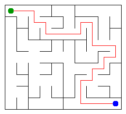

# Assignment 3. Maze Escape

Student ID: 254752  
Name: Mariyam  
Group: SE-2510  
Maze size (rows x columns): 9 x 10

This file is the report. How to start: `START_HERE.md`. The task: `docs/Assignment3.pdf`.

## Program output

The 13 lines my program prints on my data (`java -cp out Main`):

    Broken: 89
    Kept: 72
    Last broken wall: 140
    MST cost: 25696
    Heaviest broken wall: 750
    Path length: 25
    DFS visited: 45
    Dead ends: 31
    Zones: 10
    Largest zone: 15
    Is DAG: 0
    Flow stages: 7
    Fastest route cost: 14

My maze:

## Questions

Answer in your own words, two or three sentences each.

### Mission 0. What do find and union do, and what makes them fast in your code?

The find operation finds the representative of a set. The union operation connects two different sets. Path compression and union by size make these operations very fast.

### Mission 1. Why is Broken always R*C - 1, and Kept always (R-1)*(C-1)?

A maze with R*C cells needs exactly R*C - 1 broken walls to connect all cells without cycles. The remaining walls are kept, and their number is (R-1)*(C-1).

### Mission 2. My MST cost from Kruskal and from Prim, and why they are equal:

My MST cost is 25696. Kruskal and Prim use different methods, but both find a minimum spanning tree with the smallest possible total weight. That is why their minimum costs are equal.

### Mission 3. Why is there exactly one path between two cells? How did you avoid a stack overflow on a huge maze?

There is exactly one path between any two cells because the maze is a tree without cycles. I used iterative DFS with a stack instead of recursive DFS. This helps avoid a stack overflow in a large maze.

### Mission 4. Why does the second pass of Kosaraju go on the reversed graph? Why do the slides have no cycle exactly when Zones equals the number of cells?

The second pass uses the reversed graph to find strongly connected components correctly. If the number of zones equals the number of cells, each cell is in its own zone. This means the directed graph has no cycles.

### Mission 5. Why is it enough to go through the zones in the order of their numbers? What does this pass cost?

The zones are numbered in topological order, so edges between zones go from smaller numbers to larger numbers. We can calculate the longest chain and the cheapest route using dynamic programming. This takes O(n + m) time.

## AI use

I used ChatGPT to understand the assignment, learn the algorithms and fix programming errors. I also used it to get help with GitHub.

## Timing (Mission 7)

Milliseconds, 5 runs each, from `java -cp out Bench`.

| Maze | Kruskal | Prim |
|---|---|---|
| 100 x 100 | 17, 11, 12, 24, 19 (avg 17 ms) | 23, 9, 10, 8, 9 (avg 12 ms) |
| 300 x 300 | 129, 95, 76, 85, 72 (avg 91 ms) | 93, 94, 88, 104, 89 (avg 94 ms) |
| 1000 x 1000 | 1513, 1598, 1647, 1796, 1637 (avg 1638 ms) | 2490, 2459, 2613, 2623, 3018 (avg 2641 ms) |

### What do the numbers say about how the time grows?

Both algorithms take more time when the maze becomes larger. This happens because larger mazes have more cells and walls to process. In my tests, Kruskal was faster than Prim for the largest maze.

## Complexity

n is the number of cells, and m is the number of walls or slides.

| Algorithm | Time | Space | Assumptions |
|---|---|---|---|
| DSU find and union | O(α(n)) amortized | O(n) | Path compression and union by size |
| Kruskal | O(m log m) | O(n + m) | Sorting edges and using DSU |
| Prim | O(m log n) | O(n + m) | Priority queue and adjacency lists |
| DFS | O(n + m) | O(n + m) | Iterative DFS with a stack |
| Kosaraju | O(n + m) | O(n + m) | Two DFS passes and reversed graph |
| Route in the zone graph | O(n + m) | O(n + m) | Topological order and dynamic programming |

## Before you submit

- [x] `data/walls.txt`, `data/slides.txt`, and `output/maze.png` are in the repository.
- [x] `java tools/Check.java` shows all examples right.
- [x] This README is fully filled in, including program output and AI use.
- [x] The completed work is pushed to main, and the repository is public.
- [x] The repository link is attached in Moodle.
